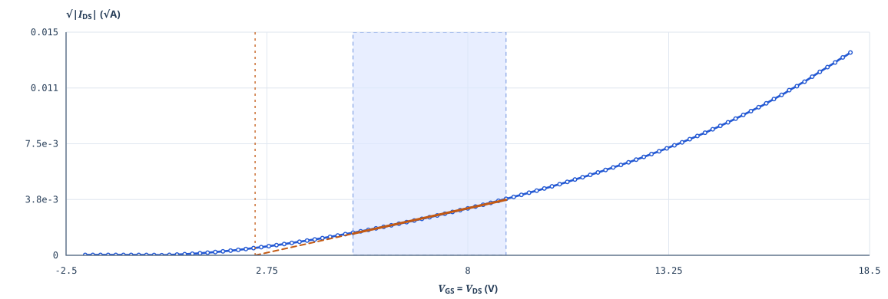

# TFT · Tauc 실험 데이터 리뷰

**측정 파일을 읽고 분석 구간과 확인할 위치를 보여주는 도구입니다.**

TFT 전기적 특성과 UV–Vis 투과율을 분석합니다. 파일·측정 조건을 먼저 확인하고, 구간에 따라 계산 결과가 얼마나 달라지는지 보여줍니다. 문제가 있으면 그래프에서 위치를 짚고, 다음에 무엇을 확인할지 안내합니다.

[화면 사용법](docs/guide.md) · [오류 사례 읽기](docs/cases.md) · [계산 방법](docs/method.md) · [데이터 출처](samples/README.md)

**[대시보드 열기 ↗](https://tft-tauc-data-review.vercel.app/)** · 로그인 없이 사용할 수 있습니다. 대표 IGZO 실측 곡선이 바로 열리며, 다른 예제나 내 파일로 바꿀 수 있습니다.



## 로컬에서 실행하기

Python 3.11 이상에서 이 폴더를 열고 실행합니다. 추가 패키지를 설치하지 않아도 됩니다.

```bash
python run.py
```

브라우저에서 **http://127.0.0.1:8765** 를 엽니다. **분석 보기**로 파일을 바꾸고, **CSV 받기**로 같은 자료를 내려받아 직접 넣어볼 수 있습니다.

## 준비한 자료

| 분석 | 물질 | 실측 파일 | 별도 오류 예제 |
| --- | --- | ---: | --- |
| TFT | a-Si · a-IGZO · LTPS | 각 3개, 총 9개 | 전류 튐 · 단차 · 고전압 감쇠 · 행 누락 · 열 이름 누락 |
| UV–Vis / Tauc | a-Si · a-IGZO · Poly-Si | 각 1개, 총 3개 | 범위 잘림 · 투과율 범위 초과 |

실측 12개 파일의 **13,812개 숫자쌍**을 분석 모듈과 별개로 원자료와 대조했습니다. TFT의 음수 전류도 부호를 보존합니다. 오류 예제 21개는 실측 복사본에서 바꾼 부분을 기록하고 제공합니다. [파일별 내역과 해시](samples/manifest.json)

## 이렇게 써보세요

- 물질과 채널 크기 W/L을 보고 파일을 선택하고, 짧은 도움말로 뜻을 확인합니다.
- 선택 구간을 같은 폭으로 ±0.5 V 옮긴 μ·Vth와 차이를 표로 비교합니다. 별도 후보의 결과와 모델 바이어스 조건도 확인할 수 있습니다.
- 오류 위치를 확대하고 실측 원본을 겹쳐 봅니다. 열 이름이 미확정이면 원본 숫자만 미리 봅니다.
- 직접 넣는 파일은 재료·W/L 또는 광학 실험 조건을 확인한 뒤 분석합니다. 잘못된 셀은 행·열과 함께 표시하고 계산을 보류합니다.
- 파일을 취소·교체하고 계산 조건·선택한 후보·검토 메모를 내려받습니다. 아직 저장하지 않은 변경은 화면에서 구분합니다.

## 더 살펴보기

| 궁금한 내용 | 문서 |
| --- | --- |
| 처음부터 화면 따라가기 | [사용법](docs/guide.md) |
| 무엇이 잘못됐고 어디를 확인하나 | [오류 사례와 그래프](docs/cases.md) |
| 후보를 고르는 기준과 계산식 | [계산 방법](docs/method.md) |
| 현재 확인한 동작과 과거 검증 | [검증 기록](VALIDATION.md) |
| 어떤 프로젝트와 가이드를 참고했나 | [참고 사례와 적용 내역](docs/references.md) |
| 코드 실행·확인·배포 구성 | [개발 안내](docs/development.md) |
| 버전별 변화 | [변경 내역](CHANGELOG.md) |

화면은 HTML·CSS·JavaScript, 분석은 Python 표준 라이브러리로 구성했습니다.
