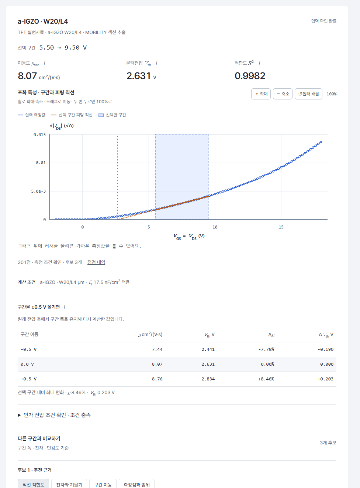
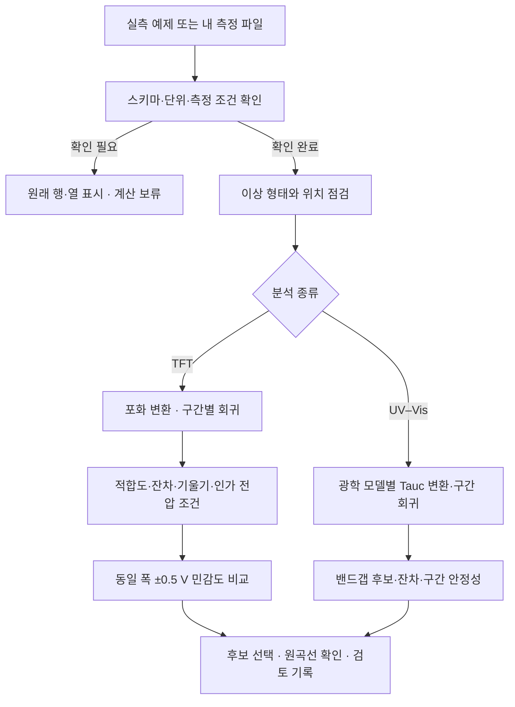

# TFT · Tauc 실험 데이터 리뷰

**측정 파일 점검부터 피팅 구간 비교와 검토 기록까지, 하나의 화면에서 진행합니다.**

[](https://github.com/mayiusethisname/tft-tauc-data-review/actions/workflows/verify.yml)


[](https://tft-tauc-data-review.vercel.app/)

### [공개 대시보드 열기 ↗](https://tft-tauc-data-review.vercel.app/)

로그인·설치 없이 사용할 수 있습니다. 대표 a-IGZO 실측 결과가 바로 열리며, 다른 실측·오류 예제를 선택하거나 내 파일을 넣을 수 있습니다.



## 핵심 구현과 검증

- **구간 선택 편차를 수치로 비교:** 후보별 적합도·잔차·기울기를 비교하고, 같은 폭의 구간을 ±0.5 V 옮겼을 때의 μ·Vth 변화를 별도로 계산합니다. 통계적 적합도와 포화 영역의 인가 전압 조건을 구분해 표시합니다.
- **원자료와 독립 대조:** 실측 12개 파일의 **측정점 13,812개**를 원자료와 대조해 불일치 0개를 확인했습니다. 전류는 원래 부호를 유지하며, 음수 전류값 664개도 보존했습니다. [출처와 파일별 해시](samples/manifest.json)
- **오류 재현과 계산 보류:** 실측 복사본으로 만든 **7가지 유형·21개 사례**에서 이상 위치를 표시하고 원본과 겹쳐 봅니다. 필수 헤더나 수치가 불명확한 파일은 원래 행·열 위치를 남기고 계산을 보류합니다. [사례별 그래프](docs/cases.md)
- **계산과 상태를 다시 확인:** 분석 회귀 검증 14개, 입력·API 경계 점검 27개를 실행했습니다. GitHub Actions는 분석 회귀·검토 상태·공개 파일 검사를 실행하며, 업로드·취소·후보 변경·확대·검토 기록 받기는 별도 브라우저 검사로 확인합니다. [검증 범위](VALIDATION.md)

## 분석 흐름



## 샘플 구성

| 분석 | 물질 | 실측 | 별도 오류 재현 예제 |
| --- | --- | ---: | --- |
| TFT | a-Si · a-IGZO · LTPS | 각 3개 · 총 9개 | 전류 튐 · 단차 · 고전압 감쇠 · 행 누락 · 열 이름 누락 |
| UV–Vis / Tauc | a-Si · a-IGZO · Poly-Si | 각 1개 · 총 3개 | 범위 잘림 · 투과율 범위 초과 |

파일 이름은 `aIGZO_W20_L04_Mobility.csv`처럼 물질·채널 폭·길이·측정 섹션을 구분합니다. W/L 도움말에는 실제 비율의 평면도와 Gate·절연막 개념도를 제공합니다.

## 상세 문서

| 내용 | 문서 |
| --- | --- |
| 계산식·후보 선정·인가 전압 조건 | [계산 방법](docs/method.md) |
| 이상 위치와 원본 비교 | [오류 사례](docs/cases.md) |
| 현재 검증과 과거 300건 평가 | [검증 기록](VALIDATION.md) |
| 원자료·추출 범위·변경 방법 | [샘플 출처](samples/README.md) |
| 업로드·후보 선택·검토 기록 | [화면 사용법](docs/guide.md) |
| 로컬 실행·검사·배포 | [개발 안내](docs/development.md) |
| 버전별 변경 | [변경 내역](CHANGELOG.md) |
| 참고 프로젝트와 적용 내역 | [참고 자료](docs/references.md) |

<details>
<summary>로컬에서 실행하기</summary>

Python 3.11 이상에서 저장소 폴더를 열고 실행합니다. 분석 서버는 Python 표준 라이브러리를 사용합니다.

```bash
python run.py
```

**내 PC에서 실행할 때만** `http://127.0.0.1:8765`를 엽니다. 다른 사람에게 공유할 주소는 위의 [공개 대시보드](https://tft-tauc-data-review.vercel.app/)입니다.

</details>
