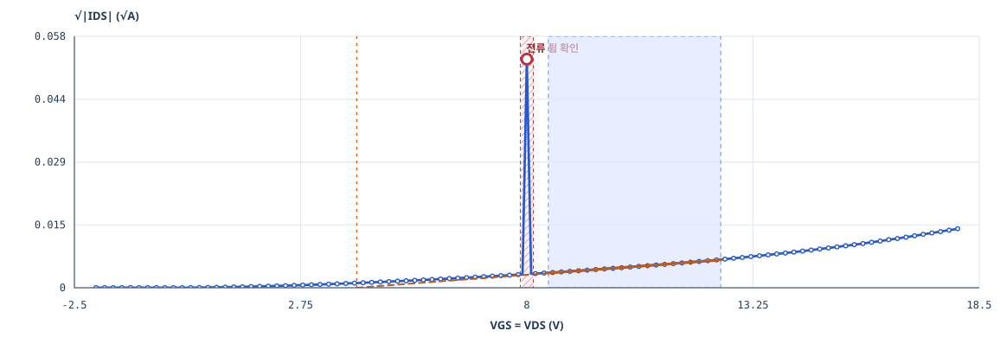
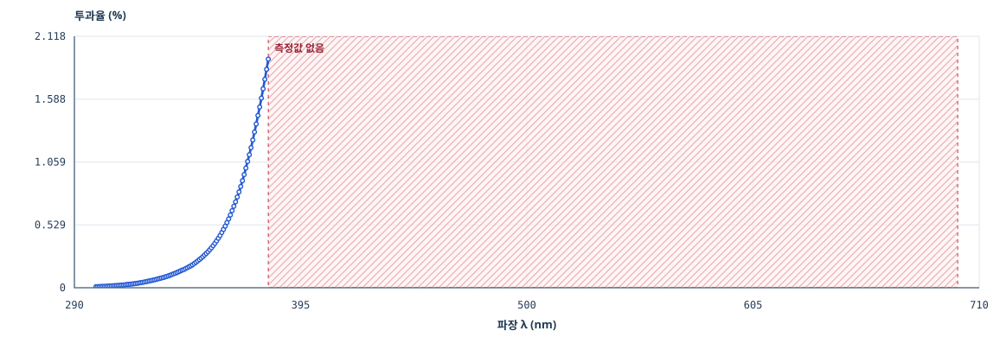

# 오류를 그래프에서 읽는 방법

실측 파일과 오류 주입 파일은 별도로 제공합니다. 오류 예제는 해당 물질의 실측 복사본을 사용하며, 파일 선택 화면에서 정상 대조 자료를 함께 열 수 있습니다.

## 전류 한 점이 튀는 경우

중앙 한 점의 전류를 원본 최대 절댓값의 15배로 바꿨습니다. 그래프는 그 점과 주변 점을 그대로 보여주고 빨간 원으로 위치를 표시합니다.

**무엇을 확인하나:** 표시한 전압에서 주변 측정점과의 차이, 원본 행, 측정 기록을 확인합니다. 원본을 겹치면 변형된 한 점과 원래 곡선의 차이를 볼 수 있습니다. 검출한 점을 자동으로 삭제하거나 보간하지 않습니다.

**절차:** 위치 확대 → 원본 겹쳐 보기 → 측정 기록 확인 → 수정 또는 재측정 파일 분석.

## 중간 측정점이 빠진 경우

중앙의 연속된 11개 행을 삭제했습니다. 보통의 전압 간격과 해당 간격을 비교하고, 벌어진 구간을 해칭으로 표시합니다. 그 사이를 선으로 연결하지 않습니다.

**무엇을 확인하나:** 내보내기 중 행이 빠졌는지, 의도적으로 간격을 바꿨는지 확인합니다. 중간을 임의로 채우지 않고 구간 피팅을 보류합니다.

**검출 규칙:** 양의 측정 간격 중앙값보다 5배 넘게 벌어진 부분을 찾습니다. 불균일 간격 자체가 소자 불량을 뜻하지는 않으며, 원본과 측정 계획을 확인하는 신호로 사용합니다.

## 전류 열 이름이 없는 경우

IDS를 UNKNOWN으로 바꾸고 숫자는 유지했습니다. 열 이름 표에서 UNKNOWN을 강조하고 **단위 미확정**인 원본 수치 그래프를 보여줍니다.

**무엇을 확인하나:** 이 열이 무엇을 측정했는지, 단위가 무엇인지 확인합니다. 열을 임의로 IDS에 연결하지 않으며 물리량 계산은 보류합니다.

**절차:** 열 이름과 단위 확인 → CSV 헤더 수정 → 파일 재선택.

## 스펙트럼 범위가 잘린 경우

헤더의 4,001점은 유지하고 실제 행은 300~380 nm의 801점만 남겼습니다.

**무엇을 확인하나:** 파란 선은 읽은 데이터만 나타냅니다. 해칭한 범위에는 값이 없습니다. 헤더 범위와 실제 범위를 대조하고 Eg 계산을 멈춥니다. 원본을 겹치면 누락된 범위의 측정값을 확인할 수 있습니다.

**절차:** 실제 범위 확인 → 전체 CSV 다시 내보내기 → 4,001점 확인 → 재분석.

## 투과율이 계산 범위를 벗어난 경우

400 nm의 투과율 한 점을 120%로 바꿨습니다. 원본 수치와 100% 기준선을 함께 그립니다.

**무엇을 확인하나:** %, 소수 표기, 기준선 설정을 확인합니다. 현재 변환은 0% 초과·100% 이하를 사용하므로 범위 밖 값이 있으면 계산을 보류합니다. 100%로 임의 보정하지 않습니다.

## 실측 파일이 모두 통과하면

확인 의견이 없더라도 선택 구간과 주변 구간의 결과 변화는 비교할 수 있습니다. 이 화면의 후보 순위는 [정해진 계산 규칙](method.md)으로 만든 순서이며, 같은 파일·설정으로 반복해서 계산할 수 있습니다.
